# Documentação completa - Sprint RH

Refatoração do banco de dados de RH e folha de pagamento (Cenário 11), aplicando Scrum, Kanban e DevOps em dupla.

## Sumário

1. [Contexto e objetivo](#1-contexto-e-objetivo)
2. [Problemas do modelo legado](#2-problemas-do-modelo-legado)
3. [Modelo refatorado](#3-modelo-refatorado)
4. [Dicionário de dados](#4-dicionário-de-dados)
5. [Migração de dados](#5-migração-de-dados)
6. [Validação](#6-validação)
7. [DML atualizado e consultas](#7-dml-atualizado-e-consultas)
8. [Versão SQLite](#8-versão-sqlite)
9. [Arquivos CSV](#9-arquivos-csv)
10. [Gestão ágil e versionamento](#10-gestão-ágil-e-versionamento)
11. [Como executar](#11-como-executar)

---

## 1. Contexto e objetivo

A empresa mantinha os funcionários em uma única tabela, `legado.funcionarios`, com cargo, departamento e benefícios digitados manualmente. O objetivo da sprint foi:

- Levantar os problemas e criar o backlog (User Stories).
- Planejar a sprint e estimar o esforço.
- Refatorar as tabelas (normalização, índices, PK/FK, eliminação de redundâncias).
- Atualizar os scripts DDL e DML.
- Versionar tudo no GitHub, com branches e Pull Requests revisados.

## 2. Problemas do modelo legado

| # | Problema | Exemplo | Consequência |
|---|---|---|---|
| 1 | Departamento em texto livre | "TI", "T.I.", "Tecnologia", "tecnologia da informação" | Cada variação conta como um departamento diferente |
| 2 | Cargo em texto livre | "Analista de Sistemas" e "Analista Sistemas", "Dev Jr" | Relatórios por cargo incorretos, sem nível padronizado |
| 3 | Benefícios em uma coluna | `'VT, VR, Plano de Saúde'`, `'vale transporte; vale refeição'` | Impossível contar beneficiários; nomes variam; sem histórico |
| 4 | Gestor como nome | `'Carlos Mendes'` | Sem integridade; vínculo se perde se o nome mudar |
| 5 | Dados sujos | CPF com máscara, e-mail `'BRUNO.LIMA@empresa.com '` | Duplicidade e inconsistência |
| 6 | Sem restrições nem índices | Só existe a PK | Consultas lentas e dados inválidos aceitos |
| 7 | Estrutura incompleta | Sem status do funcionário, sem folha | Não há como modelar afastamentos nem holerites |

## 3. Modelo refatorado

Schema `rh`, na 3ª Forma Normal.

```mermaid
erDiagram
    DEPARTAMENTO ||--o{ FUNCIONARIO : "tem"
    CARGO ||--o{ FUNCIONARIO : "ocupa"
    FUNCIONARIO ||--o{ FUNCIONARIO : "gerencia"
    FUNCIONARIO ||--o{ FUNCIONARIO_BENEFICIO : "recebe"
    BENEFICIO ||--o{ FUNCIONARIO_BENEFICIO : "concedido em"
    FOLHA_PAGAMENTO ||--o{ HOLERITE : "contém"
    FUNCIONARIO ||--o{ HOLERITE : "recebe"

    DEPARTAMENTO {
        smallint id_departamento PK
        varchar sigla UK
        varchar nome UK
        boolean ativo
    }
    CARGO {
        smallint id_cargo PK
        varchar nome UK
        varchar nivel
        boolean ativo
    }
    BENEFICIO {
        smallint id_beneficio PK
        varchar codigo UK
        varchar nome UK
        numeric valor_padrao
        boolean ativo
    }
    FUNCIONARIO {
        int id_funcionario PK
        varchar nome
        char cpf UK
        varchar email UK
        date data_admissao
        numeric salario_base
        varchar status
        smallint id_cargo FK
        smallint id_departamento FK
        int id_gestor FK
    }
    FUNCIONARIO_BENEFICIO {
        int id_funcionario PK
        smallint id_beneficio PK
        date data_inicio PK
        date data_fim
    }
    FOLHA_PAGAMENTO {
        int id_folha PK
        date competencia UK
        varchar status
    }
    HOLERITE {
        int id_holerite PK
        int id_folha FK
        int id_funcionario FK
        numeric total_proventos
        numeric total_descontos
        numeric salario_liquido
    }
```



### Decisões de projeto

- **Tabelas de domínio** (`departamento`, `cargo`, `beneficio`) eliminam o texto livre: o valor passa a existir uma única vez.
- **Relação N:N** `funcionario_beneficio` substitui a lista separada por vírgula e guarda `data_inicio` e `data_fim`, mantendo o histórico.
- **Autorrelacionamento** `id_gestor` transforma o nome do gestor em chave estrangeira. O `CHECK` impede que alguém seja gestor de si mesmo.
- **Coluna gerada** `salario_liquido = total_proventos - total_descontos` evita inconsistência no holerite.
- **Índices** nas chaves estrangeiras e um índice parcial para funcionários ativos.

### Índices criados

| Índice | Tabela | Coluna(s) |
|---|---|---|
| `idx_func_departamento` | `funcionario` | `id_departamento` |
| `idx_func_cargo` | `funcionario` | `id_cargo` |
| `idx_func_gestor` | `funcionario` | `id_gestor` |
| `idx_func_ativos` | `funcionario` | `nome` (parcial, `status = 'ATIVO'`) |
| `idx_fb_beneficio` | `funcionario_beneficio` | `id_beneficio` |
| `idx_holerite_func` | `holerite` | `id_funcionario` |

As PKs e as colunas `UNIQUE` já criam índices próprios.

## 4. Dicionário de dados

### rh.departamento

| Coluna | Tipo | Regras |
|---|---|---|
| id_departamento | SMALLSERIAL | PK |
| sigla | VARCHAR(10) | NOT NULL, UNIQUE |
| nome | VARCHAR(80) | NOT NULL, UNIQUE |
| ativo | BOOLEAN | NOT NULL, padrão TRUE |

### rh.cargo

| Coluna | Tipo | Regras |
|---|---|---|
| id_cargo | SMALLSERIAL | PK |
| nome | VARCHAR(80) | NOT NULL, UNIQUE |
| nivel | VARCHAR(20) | NOT NULL, CHECK em `ESTAGIO`, `JUNIOR`, `PLENO`, `SENIOR`, `GESTAO`, `ASSISTENTE` |
| ativo | BOOLEAN | NOT NULL, padrão TRUE |

### rh.beneficio

| Coluna | Tipo | Regras |
|---|---|---|
| id_beneficio | SMALLSERIAL | PK |
| codigo | VARCHAR(10) | NOT NULL, UNIQUE |
| nome | VARCHAR(80) | NOT NULL, UNIQUE |
| valor_padrao | NUMERIC(10,2) | NOT NULL, padrão 0, CHECK >= 0 |
| ativo | BOOLEAN | NOT NULL, padrão TRUE |

### rh.funcionario

| Coluna | Tipo | Regras |
|---|---|---|
| id_funcionario | SERIAL | PK |
| nome | VARCHAR(120) | NOT NULL |
| cpf | CHAR(11) | NOT NULL, UNIQUE, CHECK só 11 dígitos |
| email | VARCHAR(120) | NOT NULL, UNIQUE |
| data_admissao | DATE | NOT NULL |
| salario_base | NUMERIC(10,2) | NOT NULL, CHECK > 0 |
| status | VARCHAR(10) | NOT NULL, padrão `ATIVO`, CHECK em `ATIVO`, `AFASTADO`, `DESLIGADO` |
| id_cargo | SMALLINT | NOT NULL, FK para `rh.cargo` |
| id_departamento | SMALLINT | NOT NULL, FK para `rh.departamento` |
| id_gestor | INTEGER | FK para `rh.funcionario`, CHECK diferente do próprio id |

### rh.funcionario_beneficio

| Coluna | Tipo | Regras |
|---|---|---|
| id_funcionario | INTEGER | PK composta, FK (`ON DELETE CASCADE`) |
| id_beneficio | SMALLINT | PK composta, FK |
| data_inicio | DATE | PK composta, NOT NULL |
| data_fim | DATE | CHECK nulo ou maior/igual a `data_inicio` |

### rh.folha_pagamento

| Coluna | Tipo | Regras |
|---|---|---|
| id_folha | SERIAL | PK |
| competencia | DATE | NOT NULL, UNIQUE, CHECK dia 1 do mês |
| status | VARCHAR(10) | NOT NULL, padrão `ABERTA`, CHECK em `ABERTA`, `FECHADA`, `PAGA` |

### rh.holerite

| Coluna | Tipo | Regras |
|---|---|---|
| id_holerite | SERIAL | PK |
| id_folha | INTEGER | NOT NULL, FK para `rh.folha_pagamento` |
| id_funcionario | INTEGER | NOT NULL, FK para `rh.funcionario` |
| total_proventos | NUMERIC(12,2) | NOT NULL, CHECK >= 0 |
| total_descontos | NUMERIC(12,2) | NOT NULL, CHECK >= 0 |
| salario_liquido | NUMERIC(12,2) | Gerada: proventos menos descontos |

Restrição adicional: `UNIQUE (id_folha, id_funcionario)`, ou seja, um holerite por funcionário por competência.

## 5. Migração de dados

O script `03_migracao_dados.sql` roda em uma única transação (`BEGIN` ... `COMMIT`) e segue 5 passos:

1. **Carga dos domínios** com os valores oficiais de departamentos, cargos e benefícios.
2. **Tabelas de-para** no schema `migracao`, que ligam cada variação digitada (em minúsculas) ao valor oficial.
3. **Funcionários**: o CPF perde a máscara (`regexp_replace(cpf, '\D', '', 'g')`) e o e-mail vira minúsculo e sem espaços (`lower(trim(email))`).
4. **Gestor**: o nome em texto é convertido na chave estrangeira por um `UPDATE` com junção.
5. **Benefícios**: a lista é quebrada em linhas com `regexp_split_to_table(beneficios, '\s*[,;]\s*')`, e cada item é mapeado pelo de-para. A data de início do benefício é a data de admissão.

### Valores oficiais

| Departamento (sigla) | Nome |
|---|---|
| TI | Tecnologia da Informação |
| RH | Recursos Humanos |
| FIN | Financeiro |

| Cargo | Nível |
|---|---|
| Gerente de TI | GESTAO |
| Analista de Sistemas | PLENO |
| Desenvolvedor Júnior | JUNIOR |
| Gerente de RH | GESTAO |
| Analista de RH | PLENO |
| Contador | SENIOR |
| Assistente Financeiro | ASSISTENTE |

| Benefício (código) | Nome | Valor padrão |
|---|---|---|
| VT | Vale Transporte | 220,00 |
| VR | Vale Refeição | 880,00 |
| SAUDE | Plano de Saúde | 450,00 |
| GYM | Gympass | 120,00 |

### Tabelas de-para

| Tipo | Variações digitadas | Valor oficial |
|---|---|---|
| Departamento | `ti`, `t.i.`, `tecnologia`, `tecnologia da informação` | TI |
| Departamento | `rh`, `r.h.`, `recursos humanos` | RH |
| Departamento | `financeiro`, `fin.` | FIN |
| Cargo | `analista de sistemas`, `analista sistemas` | Analista de Sistemas |
| Cargo | `analista de rh`, `analista rh` | Analista de RH |
| Cargo | `dev jr` | Desenvolvedor Júnior |
| Cargo | `gerente de ti`, `gerente de rh`, `contador`, `assistente financeiro` | o próprio nome oficial |
| Benefício | `vt`, `vale transporte` | VT |
| Benefício | `vr`, `vale refeição` | VR |
| Benefício | `plano saúde`, `plano de saúde` | SAUDE |
| Benefício | `gympass` | GYM |

Para o conjunto de exemplo, a migração produz **10 funcionários** e **19 vínculos de benefício**.

## 6. Validação

O script `04_validacao.sql` deve ser executado logo após a migração. Todas as consultas devem retornar 0 linhas ou diferença 0.

| Consulta | O que confere | Resultado esperado |
|---|---|---|
| V1 | Registros do legado sem cargo ou departamento no de-para | 0 linhas |
| V2 | Quantidade de funcionários antes e depois | diferença = 0 |
| V3 | Benefícios digitados que não foram reconhecidos | 0 linhas |
| V4 | Gestor informado no legado que não virou FK | 0 linhas |
| V5 | Soma dos salários antes e depois | diferença = 0.00 |
| V6 | Plano de execução (`EXPLAIN`) da busca por departamento | Em tabelas maiores, conferir `Index Scan` |

A soma dos salários do conjunto de exemplo é 78.800,00.

## 7. DML atualizado e consultas

O script `05_dml_atualizado.sql` mostra como as operações mudam: em vez de gravar texto livre, passam a usar as chaves dos domínios.

### Operações

| Operação | Antes | Agora |
|---|---|---|
| Novo funcionário | `INSERT` com cargo e departamento em texto | `INSERT ... SELECT` que resolve `id_cargo`, `id_departamento` e `id_gestor` por chave natural |
| Conceder benefícios | Editar a lista de texto | `INSERT` em `funcionario_beneficio` |
| Promoção | `UPDATE` do texto do cargo | `UPDATE` trocando a FK `id_cargo` e o `salario_base` |
| Encerrar benefício | Apagar da lista, perdendo histórico | `UPDATE` de `data_fim`, mantendo o histórico |
| Folha mensal | Não existia | `INSERT` em `folha_pagamento` e geração dos `holerite` (cálculo didático com desconto fixo de 11%) |

### Consultas

| Consulta | Objetivo |
|---|---|
| Q1 | Headcount e massa salarial por departamento (antes: "TI" ≠ "T.I." ≠ "Tecnologia") |
| Q2 | Benefícios vigentes por funcionário, com `string_agg` |
| Q3 | Quantos funcionários recebem cada benefício |
| Q4 | Organograma: gestor e subordinados, com cargo |
| Q5 | Total da folha de 10/2026 por departamento (proventos, descontos e líquido) |

Resultado esperado da Q1 depois de executar o `05`: TI com 5 funcionários e massa de 40.000,00; RH com 3 e 24.400,00; Financeiro com 3 e 20.200,00.

> A folha de 10/2026 considera apenas funcionários ativos admitidos até 31/10/2026. Por isso a Juliana Prado, admitida em 03/11/2026, não entra nos holerites.

## 8. Versão SQLite

Existe uma versão resumida para SQLite (3.33 ou superior), em um único arquivo e sem schemas. As adaptações principais:

| PostgreSQL | SQLite |
|---|---|
| Schemas `legado`, `rh`, `migracao` | Sem schemas; tabela `legado_funcionarios` e prefixo removido |
| `SERIAL` / `SMALLSERIAL` | `INTEGER PRIMARY KEY AUTOINCREMENT` |
| `VARCHAR`, `CHAR`, `DATE`, `BOOLEAN` | `TEXT` (datas `AAAA-MM-DD`) e `INTEGER` (0/1) |
| `regexp_replace` no CPF | `replace()` encadeado; CHECK com `GLOB` |
| `regexp_split_to_table` + `LATERAL` | CTE recursiva |
| `string_agg` | `group_concat` |
| `EXTRACT(DAY FROM ...)` | `strftime('%d', ...)` |
| 3 tabelas de-para | 1 tabela `depara` com coluna `tipo` |
| Chaves estrangeiras sempre ativas | Exigem `PRAGMA foreign_keys = ON` |

## 9. Arquivos CSV

Pasta `csv/`, com os dados em UTF-8 (abrem no Excel com acentos corretos):

| Arquivo | Conteúdo |
|---|---|
| `legado_funcionarios.csv` | Tabela original, com os dados sujos |
| `departamento.csv` | Tabela de domínio de departamentos |
| `cargo.csv` | Tabela de domínio de cargos |
| `beneficio.csv` | Tabela de domínio de benefícios |
| `funcionario.csv` | Funcionários migrados, já padronizados |
| `funcionario_beneficio.csv` | Relação N:N, 19 linhas |

## 10. Gestão ágil e versionamento

### Papéis da dupla

| Papel | Responsabilidades |
|---|---|
| Product Owner / Revisor (A) | Prioriza o backlog, valida regras de negócio e aprova os Pull Requests |
| Scrum Master / Desenvolvedor (B) | Organiza o quadro Kanban, conduz a refatoração e gerencia os commits |

Ambos escrevem e revisam código.

### Quadro Kanban

Colunas: **Backlog, Sprint Backlog, Em Andamento, Em Revisão (PR) e Concluído**.

| Cartão | Tarefa | Pontos |
|---|---|---|
| RH-01 | Tabela de domínio departamento | 2 |
| RH-02 | Tabela de domínio cargo | 2 |
| RH-03 | Benefícios N:N | 5 |
| RH-04 | Funcionário com PK/FK/CHECK | 5 |
| RH-05 | Migração e validação dos dados | 8 |
| RH-06 | Índices | 2 |
| RH-07 | Folha de pagamento e holerite | 3 |
| RH-08 | DML e consultas atualizadas | 3 |
| RH-09 | GitHub, relatório e retrospectiva | 2 |

Total: 32 pontos.

### Fluxo no GitHub

1. Uma branch por cartão, nomeada `feature/rh-0X-descricao`.
2. Commits pequenos, com mensagens claras, dos dois integrantes.
3. Pull Request com o código do cartão no título e o parceiro como revisor.
4. O revisor confere em **Files changed**, aprova em **Review changes > Approve** e faz o merge na `main`.
5. O cartão é movido para **Concluído** no Trello.

### Entregáveis

- Link do quadro Kanban com as tarefas concluídas.
- Link do repositório com os scripts SQL e o histórico de commits de ambos.
- Relatório da sprint, com problemas encontrados, soluções aplicadas e retrospectiva.

## 11. Como executar

Requisito: PostgreSQL.

```bash
psql -U usuario -d banco -f sql/01_legado.sql
psql -U usuario -d banco -f sql/02_ddl_refatorado.sql
psql -U usuario -d banco -f sql/03_migracao_dados.sql
psql -U usuario -d banco -f sql/04_validacao.sql
psql -U usuario -d banco -f sql/05_dml_atualizado.sql
```

Os scripts `01` e `02` apagam e recriam os schemas `legado` e `rh` (`DROP SCHEMA ... CASCADE`). Use um banco de testes.

Para executar o `05` novamente, rode antes o `02` e o `03`, porque a inserção da Juliana Prado e a folha de 10/2026 violariam as restrições de unicidade.
